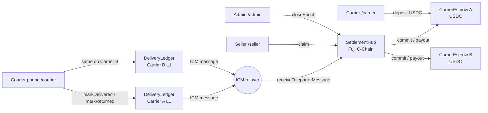

# COD Clearing (Team Snowball, Avalanche UniHack 2026)

Online sellers in Vietnam use several shipping carriers. Each carrier collects cash on delivery (COD) and pays the seller
later, on its own schedule, with its own spreadsheet. **COD Clearing gives everyone one shared, verifiable number.**

- Each carrier runs its **own Avalanche L1** with a `DeliveryLedger` contract that records order status.
- When a courier marks an order delivered or returned, the ledger sends a small **ICM (Teleporter) message** to the
  `SettlementHub` on **Fuji C-Chain**. It carries only an order hash, the seller's wallet, amounts and fees. No buyer
  personal data is on-chain.
- The hub keeps a **net balance per (carrier, seller)**, closes periods, and lets the seller **claim one payout per period**
  in testnet USDC from escrows the carriers pre-funded.

> **Honesty note.** Everything runs in **LOCAL** mode (three Anvil chains and a mock messenger and relayer). **FUJI** mode
> uses the same contracts and frontend with the real Teleporter and relayer; it needs the manual steps in
> [RUNBOOK.md](RUNBOOK.md). Check the status of your recording before claiming Fuji. The VND-to-USDC rate is a fixed demo
> value and all funds are testnet only.

## Live demo

- **Web demo (simulated, no wallet needed):** https://cod-clearing.vercel.app
- The hosted page runs the whole flow (courier, seller, admin, claim) in the browser with the same rules as the contracts, so anyone can try it.
  It is a simulation, not a connection to a live chain. The real contracts, tests and the local multi-chain demo are in this repository.
- Demo video: _VIDEO_LINK_

## Architecture



Balance effect per message: DELIVERED `+cod - fee`, RETURNED `-fee` (whole VND). `closeEpoch` moves positive balances into
that period's payouts and commits USDC in each escrow; negative balances carry over. After a dispute window (60 s in the
demo) the seller calls `claim(epoch)`. Duplicate `seq` values are ignored without reverting, so the relayer never retries forever.

## Contract addresses

LOCAL addresses are deterministic on a fresh `pnpm demo:local`. FUJI addresses are written to `deployments/fuji.json` by `pnpm deploy:fuji`.

| Contract | Chain | LOCAL | FUJI |
|---|---|---|---|
| SettlementHub | hub (31337 / Fuji 43113) | `0x9fE46736679d2D9a65F0992F2272dE9f3c7fa6e0` | _see `deployments/fuji.json`_ |
| Messenger | every chain | mock `0x5FbDB2315678afecb367f032d93F642f64180aa3` | `0x253b2784c75e510dD0fF1da844684a1aC0aa5fcf` |
| USDC | hub | MockUSDC `0xe7f1725E7734CE288F8367e1Bb143E90bb3F0512` | `0x5425890298aed601595a70AB815c96711a31Bc65` |
| DeliveryLedger A | carrier A (20261) | `0xe7f1725E7734CE288F8367e1Bb143E90bb3F0512` | _see json_ |
| DeliveryLedger B | carrier B (20262) | `0xe7f1725E7734CE288F8367e1Bb143E90bb3F0512` | _see json_ |
| CarrierEscrow A | hub | `0xCf7Ed3AccA5a467e9e704C703E8D87F634fB0Fc9` | _see json_ |
| CarrierEscrow B | hub | `0xDc64a140Aa3E981100a9becA4E685f962f0cF6C9` | _see json_ |

## Requirements

Node 20+ (tested on 23), pnpm 9, [Foundry](https://getfoundry.sh) (`forge`, `anvil`, `cast`), `jq` (only for `scripts/e2e-local.sh`).

```bash
pnpm install
cp .env.example .env     # only needed for Fuji
```

## Run the tests

```bash
pnpm test                # forge test: 19 tests incl. a fuzz test
```

## Run LOCAL

```bash
pnpm demo:local          # starts 3 Anvils (8545 hub, 8546 carrier A, 8547 carrier B), deploys, seeds, runs the mock relayer
```

In another terminal:

```bash
pnpm web:dev             # http://localhost:3000   (NEXT_PUBLIC_MODE=local)
```

Add the three networks to your wallet (RPC `http://127.0.0.1:8545|8546|8547`, chain IDs 31337, 20261, 20262; the app offers to add them) and import these **public Anvil dev keys**, local use only:

| Role | Anvil account | Private key |
|---|---|---|
| Courier | #1 | `0x59c6995e998f97a5a0044966f0945389dc9e86dae88c7a8412f4603b6b78690d` |
| Seller | #4 | `0x47e179ec197488593b187f80a00eb0da91f1b9d0b13f8733639f19c30a34926a` |
| Admin / hub owner | #0 | `0xac0974bec39a17e36ba4a6b4d238ff944bacb478cbed5efcae784d7bf4f2ff80` |
| Carrier A / B wallets | #2 / #3 | see `scripts/lib.ts` |

Demo script:

1. `/courier`: connect the courier, choose a carrier, tap **Delivered & paid** or **Returned**, confirm.
2. `/seller`: the balance changes within seconds.
3. `/admin`: connect the admin and click **Close period**.
4. After 60 s, `/seller`: click **Claim**. One transaction pays from both escrows.

No browser? `./scripts/e2e-local.sh` runs the same flow with `cast` against a running `pnpm demo:local`.

## Run FUJI

Follow [RUNBOOK.md](RUNBOOK.md) (L1 creation, ICM Setup, relayer, faucets), then:

```bash
pnpm deploy:fuji         # writes deployments/fuji.json
pnpm ping:fuji           # one message carrier A -> hub, prints the elapsed time (pnpm ping:fuji B for carrier B)
pnpm seed:fuji
NEXT_PUBLIC_MODE=fuji pnpm web:dev
```

## Layout

```
contracts/   Foundry project: src/, test/, script/ (DeployLocal, DeployFuji)
scripts/     seed, mock-relayer, fuji-ping, demo-local, e2e-local.sh, deploy-fuji.sh
web/         Next.js app (courier, seller, carrier, admin)
deployments/ local.json / fuji.json written by the deploy scripts
```

## Out of scope (by design)

Out-of-order message buffering (duplicates only are rejected), STATEMENT and ADJUSTMENT messages, dispute resolution (only a time window before claim), TeleporterRegistry, an indexer or database (lists come from `getLogs`), ICTT, native apps, and any token of our own.

## Known limitations

- `closeEpoch` loops over all sellers and reverts if any carrier's escrow is underfunded, so one underfunded carrier blocks the close for everyone.
- Balances that convert to less than 0.000001 USDC stay in the balance (dust).
- Contracts are a hackathon MVP and not audited. Owner and admin roles are single wallets (use a multisig in production).
